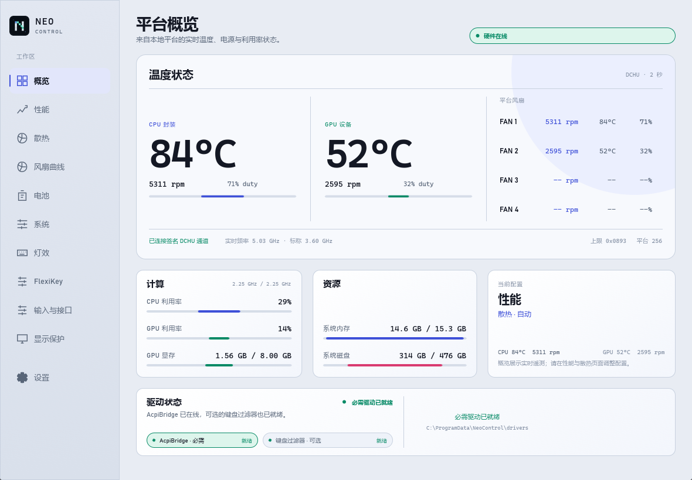

# Neo Control

Native Windows control center for compatible CC4.0 platforms, built with Rust
and Slint. The current hardware validation baseline is the Firebat/Clevo ZY-T6K.



Neo Control provides a fast, Chinese-first desktop interface for platform power,
cooling, lighting, battery, display, input and FlexiKey controls. Hardware
access goes through the signed `AcpiBridge` and `HKKbdFltr` driver interfaces;
firmware and driver signatures remain unchanged.

## Highlights

- Native Rust + Slint UI with GPU compositing and a compact tray-resident shell
- Power profiles, fan policies, custom curves and a ten-point RPM editor
- Thermal, clock, memory, disk, battery and optional NVIDIA telemetry
- Keyboard RGB, charging policy, GPU mode and panel refresh controls
- FlexiKey profiles, binding editor and resident keyboard/mouse action engine
- Windows display care with readback and rollback
- Headless boot service that restores the saved power policy before login
- Chinese and English interface switching

## Architecture

```text
neo-control
  -> neo-control-protocol
  -> Slint / Win32

neo-control-protocol
  -> signed AcpiBridge and HKKbdFltr device interfaces
```

The workspace is split into a typed protocol layer, a serialized hardware
worker and an independently editable Slint UI tree. See
[`docs/architecture.md`](docs/architecture.md) for details.

## Compatibility

The protocol and UI layers are capability-driven and designed for CC4.0/DCHU
platforms. Compatible machines can reuse the same architecture, with these
model-level checks before enabling write controls:

- verify the `AcpiBridge` ACPI device path; the default is `CLV0001` and can be
  overridden with `NEO_CONTROL_ACPI_DEVICE` for another model;
- verify the capability page, fan count and fan-channel mapping;
- compare model-specific AppSettings offsets and power/fan transitions with the
  vendor Control Center;
- start with read-only telemetry, then exercise the reversible hardware smoke
  suite on that exact machine.

`Firebat/Clevo ZY-T6K` is the validated reference implementation; other CC4.0
models require their own readback validation before write support is enabled.

## Build and verify

Development and cross-compilation run in WSL/Arch with the configured Zig
linker:

```bash
./scripts/verify.sh
```

The gate runs formatting, host tests, Windows-target Clippy with warnings
denied, and the Release build. On a Windows host with the signed drivers
installed, run the reversible hardware smoke suite:

```powershell
pwsh -File scripts/hardware-smoke.ps1
```

The Release executable is written to:

```text
target/x86_64-pc-windows-gnu/release/neo-control.exe
```

## Documentation

- [Architecture](docs/architecture.md)
- [Feature parity](docs/cc40-feature-parity.md)
- [Protocol map](docs/protocol-map.md)
- [Verification log](docs/verification.md)
- [Quality assessment](docs/quality-assessment.md)
- [Binary replacement notes](docs/binary-replacement.md)

## License

MIT. See [LICENSE](LICENSE).
